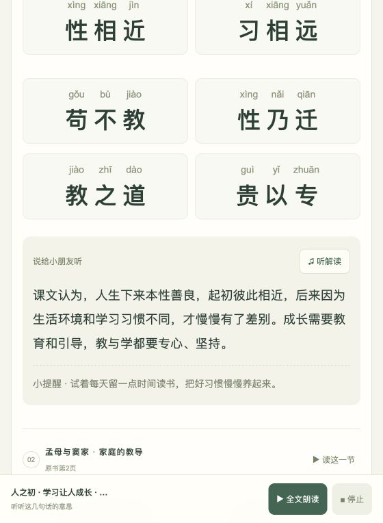

# 三字经 · 小小朗读家

一个帮助小朋友**认读《三字经》、练习背诵、理解句意**的学习网站。把长长的经典拆成可以轻松开始的三个字，让孩子点一点、听一听、跟着读，再用自己的话说一说。

适合小学生自主练习，也适合家长陪读和老师开展经典启蒙教学。手机、平板、电脑都可以使用，无需注册、无需安装应用。

**[打开网站，开始读书](https://sameordiff.github.io/sanzijin/)**

> 每天读一点，慢慢记心间。学习不只为了背下来，也为了读懂、想明白。

## 可以怎样帮助孩子

| 学习需要 | 网站里的做法 |
| --- | --- |
| 有些字还不认识 | 每个汉字上方标注拼音，提供大字和更大字号 |
| 不知道怎么读 | 每组三个字都能点读，也可以朗读一课或全文 |
| 跟读速度太快 | 可选择正常读或慢慢读 |
| 背着背着想不起来 | 背诵模式遮住文字，点一句显示提示并发音，再点一次重新遮住 |
| 想重新挑战背诵 | 顶部和底部都有“一键遮住”，收起全部提示、停止声音，留在当前位置继续背 |
| 会背却不明白意思 | 每课配有适合小朋友理解的白话解读和生活小提醒，解读也可以收听 |
| 全文太长，不好找 | 按48课编排，提供“选一课”跳转，并标明原书页码 |

## 三种学习模式

### ① 跟着读：先认字，再读顺

打开课文后，点任意三个字即可听发音。听清之后自己跟读一遍，再把相邻的句子连起来读。每两行之间留出更宽的空白，帮助孩子看清位置、保持阅读节奏。

### ② 试着背：需要时才看提示

文字和拼音先遮住，让孩子尝试自己背。想不起来时，点对应的一组字，就会显示文字并发音；再点同一组，文字重新遮住。

点“一键遮住”可以收起全部提示，并停止播放。页面不会回到开头，可以接着刚才的位置继续背。

### ③ 懂意思：把经典和生活联系起来

每课提供“说给小朋友听”的白话说明和“小提醒”。用孩子熟悉的学习、家庭和同伴相处场景，帮助他们理解词句，而不是只记住声音。

古代传说、历史概括和古代社会观念会结合背景解释；陪读时可以一起讨论今天怎样做到关爱、诚信、尊重和负责。

## 建议的陪读方法

1. **每天选一小段。** 不急着一次背完，先完成孩子能掌握的目标。
2. **先听，再跟读。** 允许孩子多听几次，重点是读清楚、读顺。
3. **听一听解读。** 问孩子：“这句话是什么意思？生活中遇到过吗？”
4. **遮住试着背。** 忘记时使用单句提示，熟悉后再一键遮住。
5. **鼓励具体的进步。** 比如今天认识了一个新字、读顺了一句、讲明白一个道理。

学习应当有适当的休息和玩耍，不以速度、背诵数量或成绩评价孩子的全部价值。

## 课文版本与教学内容

- 汉字正文依据指定的《三字经(2).pdf》整理，共 **1134字、48课、378组三字**。
- 每课对应原书一页正文，并保留该版本的用字与顺序。
- “作中庸，子思笔”“七情具”“宇文周，与高齐”“廿二史”“心而维”等均按该版本保留。
- 原PDF“当师叙”疑为“当顺叙”的排印错误：网站保留原字，并在相应课文与解读中明确注明，便于家长和老师核对。
- 拼音根据字义标注本调，朗读时可能出现自然变调；没有照搬原PDF里所有可能错印的拼音。
- 白话解读和小提醒属于新增教学内容，与原文分开呈现。

## 声音与学习记录

网站优先使用设备或浏览器提供的中文合成语音，支持普通话与粤语试听和切换（包含 `yue-HK`、`yue-Hant-HK`、`zh-HK` 等粤语标识）；声音列表已排除台湾中文语音。可用音色和自然程度取决于设备、浏览器以及已安装的语音。

配套提供 **422段MP3点读与解读音频**：在系统没有可用中文语音或播放失败时作为备用。备用音频为普通话合成语音，不是真人录音，也不包含粤语录音。手机能否显示粤语取决于浏览器提供的声音；本次兼容修复无法代替设备语音包。首次播放需要加载对应音频。

已听进度和声音选择保存在当前浏览器本地，不需要账号，也不会自动在不同设备之间同步。

## 网站预览



## 本地运行

这是纯HTML、CSS、JavaScript网站，无需安装Node.js、无需数据库，也不需要云端API密钥。

在项目目录打开终端，运行：

```bash
python3 -m http.server 8000
```

然后用浏览器打开 `http://localhost:8000`。

请通过HTTP服务器运行，不要直接双击 `index.html`，因为课文数据通过 `fetch` 加载。

## 发布到 GitHub Pages

仓库的 `Settings → Pages` 中选择：

- Source：`Deploy from a branch`
- Branch：`main`
- Folder：`/(root)`

保存后等待发布完成。`index.html` 位于仓库根目录，所有资源使用相对路径，适用于项目型GitHub Pages网站。

## 文件结构

```text
.
├── index.html             # 页面结构
├── style.css              # 大字、留白与手机适配
├── app.js                 # 点读、背诵、声音与选课交互
├── data.json              # 全文、逐字拼音、解读与页码
├── audio/                 # 点读与解读的MP3备用音频
├── pdf-edition-text.txt   # 本版本汉字正文
├── preview.png            # 网站预览
└── README.md              # 项目介绍与使用说明
```

愿每个孩子都能在一字一句中获得理解，在一点一滴中积累自信。
